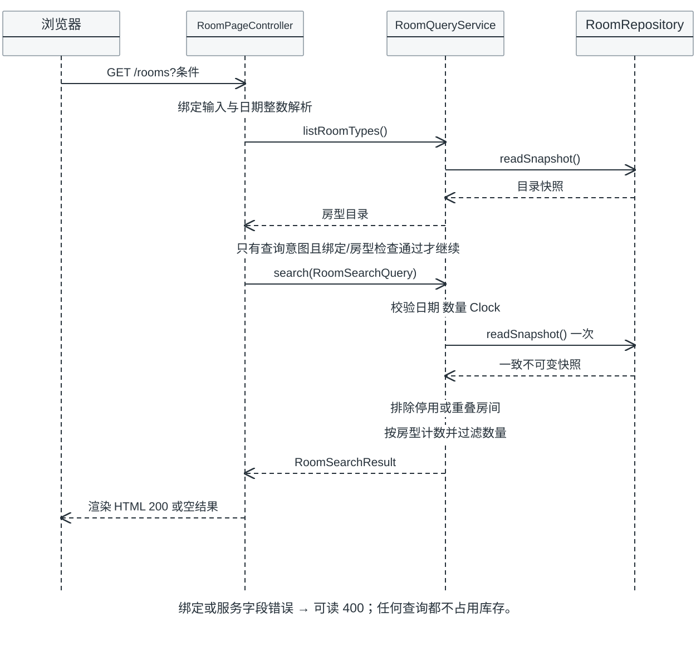

# 可用性查询交互

当前已实现的Room只读搜索，B-DESIGN-2026-10-29-01。以下图不包含创建Booking、支付或库存分配。图里的readSnapshot是search内使用的快照，页面额外目录读取在文字中说明。

可编辑源：[availability-query.mmd](availability-query.mmd)。

## 调用顺序和分支

1. 浏览器GET /rooms。RoomPageController绑定白名单arrival/departure/rooms/roomType；RoomSearchForm负责字符串到日期/整数的绑定。Controller先调用listRoomTypes读取目录，规范化all/空房型为null，检查未知房型。
2. 完全未传arrival/departure/rooms时只显示目录，不显示可用数量。任意一个被传入才进入查询意图。未知房型或绑定失败在Controller返回400；不会继续search。
3. 缺少rooms参数默认1；显式空/无法绑定的rooms拒绝。Controller构造RoomSearchQuery并调用RoomQueryService.search。Service独立检查缺日期、过去入住、非递增住期与非正数量。
4. 合法search只调用一次RoomRepository.readSnapshot取得一致不可变快照。验证非空房型存在，构造StayPeriod。所有与请求住期重叠的Block对应roomId放入Set，重复Block不重复扣减。
5. 对每个候选RoomType，只数enabled且不在阻塞Set中的物理Room；availableRooms必须>=roomCount才保留该房型。返回RoomSearchResult，B只格式化基础价格，不计算最终房费。
6. RoomPageController构造RoomCardView并渲染。成功和无结果200；InvalidRoomSearchException.field映射可读400。结果空不等于查询格式非法，也不等于临时锁房。

目录读取与search快照可能来自不同瞬间；当前只保证search自己的计算一致，未承诺一个HTTP响应中所有目录/价格与数量均为同一跨调用事务版本。真实报价/创建需要C确认版本、重查、价格快照与库存事务。

## 连续可用反例

请求[11-08,11-10)。若房间A只在第一晚可用，房间B只在第二晚可用，即使每天都有1间空房，也没有同一间房可住满两晚。当前算法把任何重叠Block的整间房排除，因此结果是0间。不能按每日空房数取最小值后就当连续可分配数量。

| 情况 | 当前结果 | 证据位置 |
| --- | --- | --- |
| 占用退房=新入住 | 不重叠 | StayPeriodTest |
| 同房多条重叠Block | 只排除该房一次 | DefaultRoomQueryServiceTest |
| enabled=false | 不计入 | DefaultRoomQueryServiceTest |
| 请求数量大于连续可用数 | 空options、HTTP200 | Service/Web测试 |
| 搜索后再重复搜索 | 不改库存 | Service/Web只读测试 |
| Service直接收到非法住期 | 字段异常 | DefaultRoomQueryServiceTest |

## 创建阶段的待接入设计

C编排真实Booking创建时，要与B/D在同一事务内复核、分配、写有效占用并保存价格快照；失败整体回滚。支付结果不明确时先核对，再依据共同确认的状态决定释放。上述是团队已同意方向，当前没有分配/释放Java端口、SQL锁或定时任务；不能把readSnapshot+updateSnapshot拼在Controller里当作已完成预订事务。

需求追踪：FR-ROOM-002/003/005/006；来源 [DefaultRoomQueryService](../../src/main/java/com/holidayresort/booking/room/application/DefaultRoomQueryService.java)、[RoomPageController](../../src/main/java/com/holidayresort/booking/room/web/RoomPageController.java)、[StayPeriod](../../src/main/java/com/holidayresort/booking/room/domain/StayPeriod.java)、[测试](../test/room-query-tests.md)。
