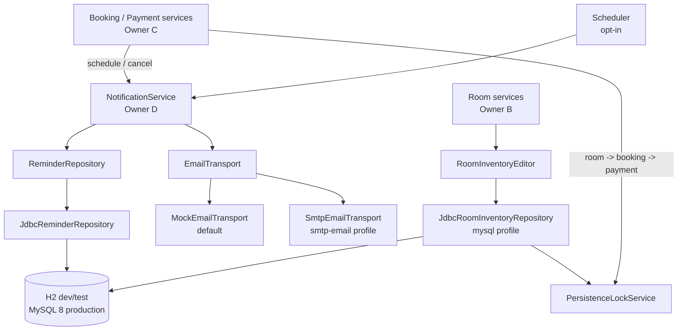
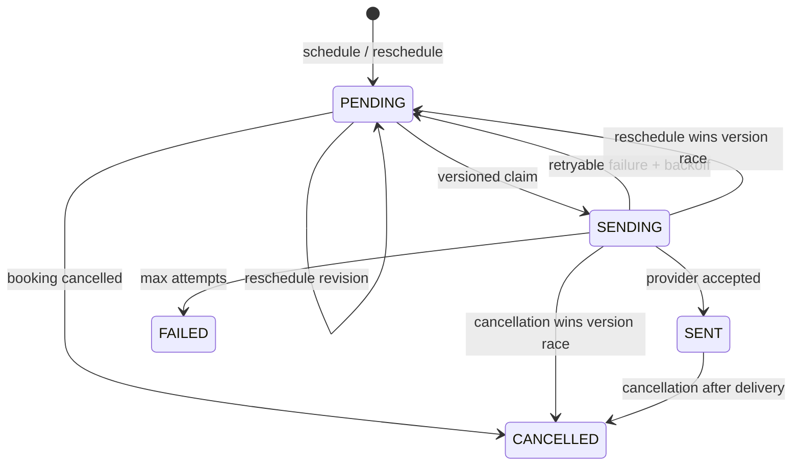
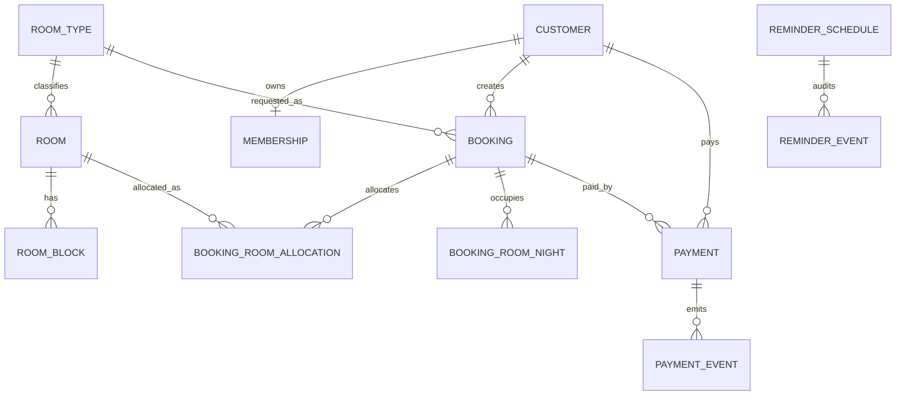

# D：通知与持久化设计交付

状态：2026-11-07，对应 Stage 1 RS v1.0 和 Stage 2 DS draft。此文件是 D 的实现说明与 A/B/C 联调入口，不替代正式课程报告中的图号或团队冻结记录。

## 1. 组件与依赖



Controllers never access D tables. C calls `NotificationService` after its own booking transaction commits; room/booking/payment cross-module writes use one transaction and the D-owned lock order.

## 2. 提醒状态与发送



The email body contains booking reference, arrival, departure and room type. It contains no password, session or account credential. Delivery errors are reduced to a stable code before persistence/logging.

## 3. 持久化模型



`booking_room_night(room_id, stay_date)` is the DB-level overlap guard. A booking of `n` rooms for `m` nights writes `n*m` rows atomically with the booking and allocation; rollback removes all of them. Released/cancelled allocations stop contributing to Room availability.

`reminder_schedule.booking_reference` is currently a soft reference rather than a foreign key because C's booking lifecycle contract is not frozen. The reminder remains an independently retryable outbox row.

## 4. 事务与锁

Canonical order:

```text
ROOM_INVENTORY -> BOOKING -> PAYMENT
```

- Room catalogue/management: `ROOM_INVENTORY`.
- Booking creation/change/cancel: `ROOM_INVENTORY`, then `BOOKING`.
- Payment creation/callback/reconciliation or inventory release: `ROOM_INVENTORY`, then `BOOKING`, then `PAYMENT`.
- The lock service rejects calls without an active transaction.
- External email and payment-provider calls never run while a database transaction is open.

## 5. A/B/C 联调清单

| Owner | Required input/action |
| --- | --- |
| A | Normalize email with trim + lowercase before persisting `email_normalized`; provide approved BCrypt hashes; define Member repository port |
| B | Continue using `RoomInventoryEditor`; JDBC implementation is selected only with `mysql` profile |
| C | Call `scheduleOneDayReminder` after create/change commit, `cancelOneDayReminder` after cancellation commit; use D lock service in booking/payment transactions; provide Booking/Payment repository ports |
| D | Finish A/C JDBC adapters after ports freeze; run MySQL 8 and live SMTP integration; add SENDING lease recovery and provider idempotency |

## 6. 验证依据

- `SchemaContractTest`：完整迁移、种子、唯一键、逐夜占用、支付幂等和 purpose 约束。
- `JdbcRoomInventoryRepositoryTest`：快照读取、审计写入、并发冲突和 block 所有权。
- `ReminderServiceTest` / `JdbcReminderRepositoryTest`：时区、幂等、重排、取消、重试、领取与错误码。
- `SmtpEmailTransportTest`：消息映射和 provider 错误转换。
- `JdbcPersistenceLockServiceTest`：规范顺序和事务强制。
- `CleanTestDataResetTest`：重复清理可变业务数据且保留迁移种子。