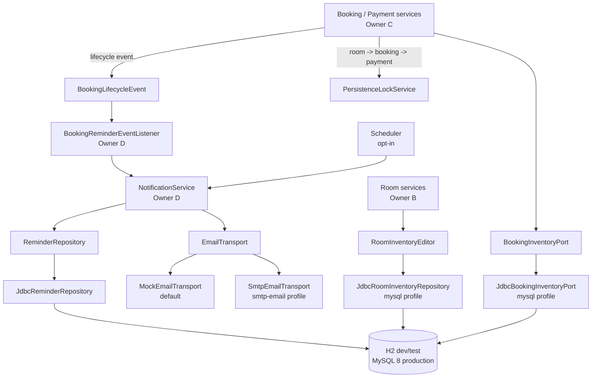
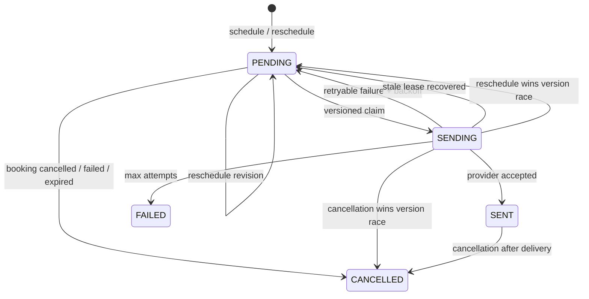
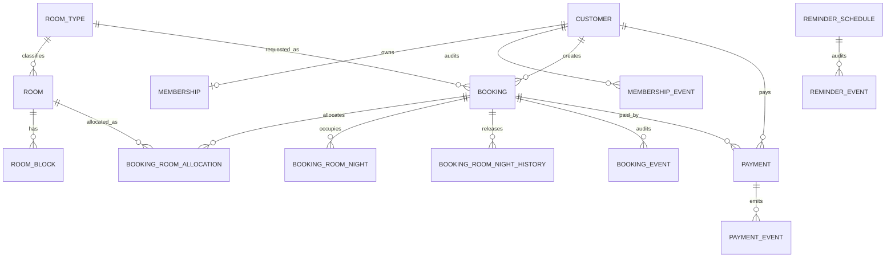

# D：通知与持久化设计交付

状态：2026-11-13，对应 Stage 1 RS v1.0 和 Stage 2 DS draft。此文件是 D 的实现说明与 A/B/C 联调入口，不替代正式课程报告中的图号或团队冻结记录。

## 1. 组件与依赖



Controllers never access D tables. C publishes a lifecycle event inside its booking transaction; D's listener writes the reminder outbox in that same transaction. Email delivery occurs after commit through the scheduler. Room catalogue management and booking allocation use separate ports and the D-owned lock order.

## 2. 提醒状态与发送



The email body contains booking reference, arrival, departure and room type. It contains no password, session or account credential. Delivery errors are reduced to a stable code before persistence/logging. A stale `SENDING` row is recovered after the configured lease; if the attempt budget is exhausted it becomes `FAILED` and remains visible for staff follow-up.

## 3. 持久化模型



`booking_room_night(room_id, stay_date)` is the active DB-level overlap guard. Allocation writes `n*m` active rows atomically with the booking and allocation. Release copies those rows to append-only `booking_room_night_history`, then removes only the active projection so the room can be sold again without erasing release evidence.

`reminder_schedule.booking_reference` remains a soft reference so reminder delivery can be retried independently. Booking and membership state changes have separate audit tables; business rows are not physically deleted.

## 4. 事务与锁

Canonical order:

```text
ROOM_INVENTORY -> BOOKING -> PAYMENT
```

- Room catalogue/management: `ROOM_INVENTORY`.
- Booking creation/change/cancel: `ROOM_INVENTORY`, then `BOOKING`.
- Payment creation/callback/reconciliation or inventory release: `ROOM_INVENTORY`, then `BOOKING`, then `PAYMENT`.
- `JdbcBookingInventoryPort` acquires the room and booking locks before re-reading availability and invoking C's booking factory.
- `PaymentTransactionService` owns the transactional state update; `PaymentService` performs provider query outside the transaction, then applies the result so payment and booking state commit together.
- The lock service rejects calls without an active transaction.
- Email delivery never runs while a database transaction is open.

## 5. A/B/C 联调清单

| Owner | Required input/action |
| --- | --- |
| A | Normalize email with trim + lowercase; provide approved BCrypt hashes; use D's `JdbcMemberRepository`, `JdbcMembershipRepository`, `JdbcStaffDirectory` in `mysql` profile |
| B | Continue using `RoomInventoryEditor` for staff room management; use the JDBC implementation only in `mysql` profile |
| C | Publish booking lifecycle events from create/change/cancel/payment paths; keep C's booking/payment rules in the factory and PaymentService; use `BookingInventoryPort` and D lock/tx boundary |
| D | Maintain H2/MySQL schema, JDBC adapters, reminder outbox, lease recovery, CI, test register and evidence index |

## 6. 验证依据

- `SchemaContractTest`：8 个迁移、种子、唯一键、逐夜占用、支付幂等、purpose 约束和 V8 审计表。
- `JdbcRoomInventoryRepositoryTest`：Room 快照、审计写入、并发冲突和 B/C port 边界。
- `JdbcReminderRepositoryTest`：时区、幂等、重排、取消、重试、版本化领取、失败和 SENDING lease 恢复。
- `MySqlProfileIntegrationTest`：mysql profile wiring、Customer/Membership/Staff/Booking/Payment JDBC、幂等提交、重复回调、booking/payment/reminder lifecycle。
- `MySqlLiveIntegrationTest`：真实 MySQL 8 migration smoke，只有提供 `MYSQL_URL` 时运行。
- `SmtpEmailTransportTest`：Mock/SMTP 映射与 provider 错误转换，不使用真实凭据。
- `JdbcPersistenceLockServiceTest`：固定锁序和事务强制。
- `CleanTestDataResetTest`：重复清理可变业务数据且保留迁移种子。

## 7. 已知限制

- 真实 MySQL 8 和真实 SMTP 的最终运行证据必须来自 CI/受控环境，不能用 H2 或 Mock 结果替代。
- C 的取消/改期业务方法尚未完整实现；listener 和持久化能力已准备，但不声称端到端完成。
- 会员费支付的 C 侧编排尚未实现；schema 与 adapter 已预留 `MEMBERSHIP` purpose。
- Q8 三天提醒只做设计演进，不进入当前实现范围。
