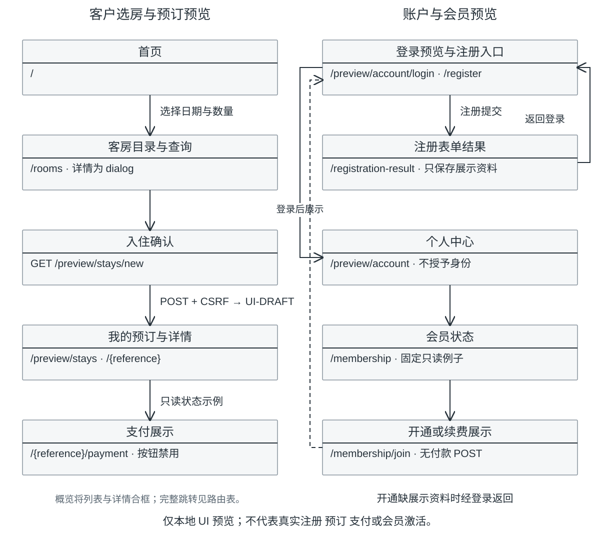
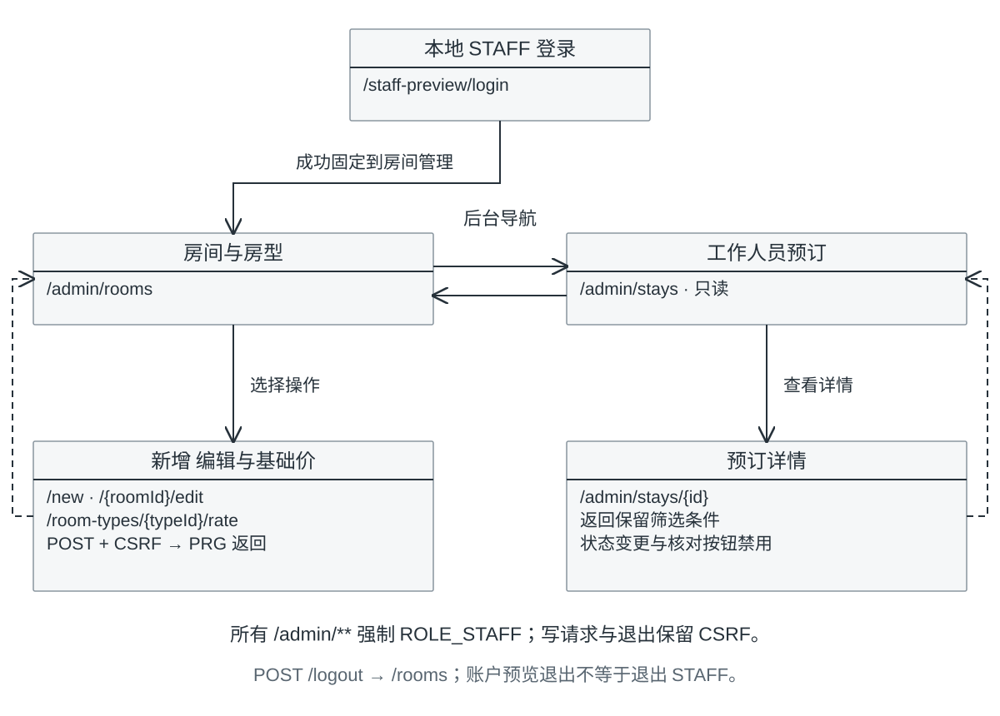

# 页面导航与访问边界

B-DESIGN-2026-10-29-01。箭头表示当前页面的链接、提交或重定向；禁用控件不画成可完成的业务流程。省略公共页头/页脚的重复返程。真实生产路由尚未冻结。

## 客户页面

源：[customer-navigation.mmd](customer-navigation.mmd)。booking-ui和account-ui是独立开关；仅在同时启用时才出现跨模块预览链接。默认仅公开首页、客房、资源/health。注册只生成本会话展示结果，随后需填写登录预览；它不自动认证。会员开通/续费缺展示资料时先经登录预览返回原页面；这是页面逻辑而非真实身份保护。

| 页面 | 现有方法和路径 | 状态与返回 |
| --- | --- | --- |
| 首页 | GET / | 房间/搜索/探索导航；客户介绍锚点 |
| 客房目录和结果 | GET /rooms | 无日期目录、有日期查询、400/空；详情为原生dialog，不是独立URL |
| 入住确认 | GET /preview/stays/new | 接收roomType/arrival/departure/rooms；再次查询但不占库存 |
| 草稿生成 | POST /preview/stays | CSRF、验证；成功PRG至本会话UI-DRAFT；400/409保留输入 |
| 我的预订 | GET /preview/stays | 当前会话草稿及固定例子；example=empty为空；草稿仅当前Session |
| 预订详情和支付 | GET /preview/stays/{reference} 及 /payment | 无记录404；草稿可回确认调整；支付按钮禁用 |
| 登录预览 | GET和POST /preview/account/login | 成功仅切换展示资料，按白名单next返回；错误400清空密码 |
| 注册和结果 | GET和POST /preview/account/register；GET /preview/account/registration-result | POST成功PRG到结果；无本会话结果404；到登录预览不等于真实注册 |
| 个人中心 | GET /preview/account | 没展示资料302登录预览；POST /preview/account/logout仅清本模块展示 |
| 会员 | GET /preview/account/membership | none/active/expired/pending固定只读例子 |
| 开通或续费 | GET /preview/account/membership/join?intent=join或renew | 需展示资料、否则经登录返回；无付款POST |

所有客户preview均仅dev+回环，不应接真实资料后保持匿名。正式客户入口由A认证CUSTOMER，C在Service验证订单归属；没有确认前不在这里臆造生产URL。演示账户退出不等于真正POST /logout，不应清真实STAFF Session或Stay草稿。

## 工作人员页面

源：[staff-navigation.mmd](staff-navigation.mmd)。/admin/**始终由SecurityFilterChain要求ROLE_STAFF；默认匿名403，可选local-staff下匿名302本地登录。登录成功固定到房间管理，不承诺自动回原受保护URL。预订导航仅staff-booking-ui启用时出现。

| 方法和路径 | 页面或行为 | 成功与失败 |
| --- | --- | --- |
| GET /staff-preview/login | 可选local-staff登录表单 | 认证由Spring Security处理；不是账户UI预览 |
| GET /admin/rooms?type=&state=all | 房间列表/筛选 | 空结果200；字段非法400 |
| GET /admin/rooms/new；POST /admin/rooms | 新增 | 成功PRG；非法400/重复409 |
| GET /admin/rooms/{roomId}/edit；POST /admin/rooms/{roomId} | 修改房型/启用状态 | 固定房号；当前未来占用保护409 |
| POST /admin/rooms/{roomId}/disable | 停用确认提交 | 成功PRG；有占用409，不删除历史 |
| GET和POST /admin/room-types/{typeId}/rate | 基础价表单/更新 | 成功PRG；精度/范围非法400 |
| GET /admin/stays | 预订列表 | reference/arrival/state交集；非法400/空200 |
| GET /admin/stays/{id} | 预订详情 | 返回保留已知筛选条件；缺记录404 |
| POST /logout | 退出真实本地STAFF Session | CSRF；成功到/rooms |

STAFF预订详情没有状态变更/收款/核对POST，相关按钮禁用。停用是Room真实内存修改；客户草稿与工作人员预订例子没有真实Booking副作用。每种失败都留在所属模块的可读错误页，不能通过返回地址跳转到站外。

来源：[布局片段](../../src/main/resources/templates/fragments/layout.html)、[Room Controller](../../src/main/java/com/holidayresort/booking/room/web/)、[Stay](../../src/main/java/com/holidayresort/booking/web/stay/StayPreviewController.java)、[Account](../../src/main/java/com/holidayresort/booking/web/account/AccountPreviewController.java)、[Staff Stay](../../src/main/java/com/holidayresort/booking/web/staffstay/StaffStayPreviewController.java)、[安全配置](../../src/main/java/com/holidayresort/booking/config/SecurityConfiguration.java)。
