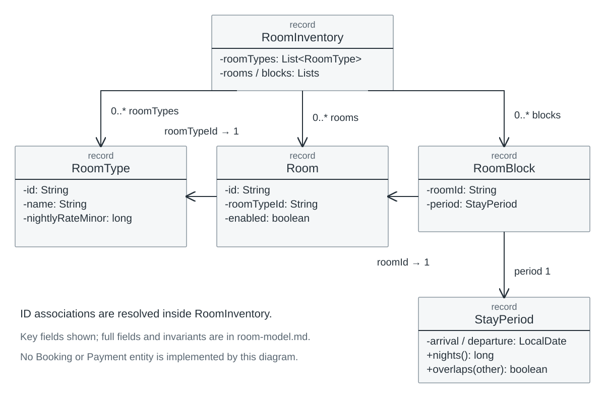
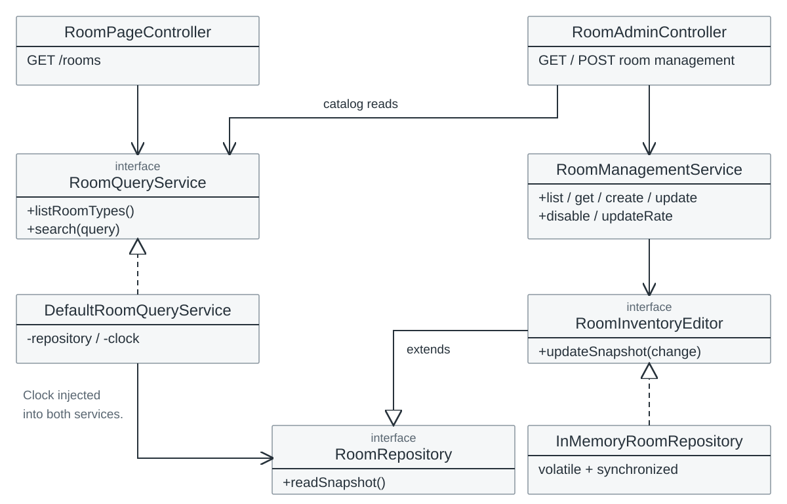

# Room 对象与依赖

B-DESIGN-2026-10-29-01。以下均按当前 Java 源码整理，跨模块契约待 C/D 评审。源码根目录为 `src/main/java/com/holidayresort/booking/`。

## 领域类图



可编辑源：[room-domain.mmd](room-domain.mmd)。图只列关键属性；全部构造字段见源码。Room 与 RoomType、RoomBlock 与 Room 的关联通过字符串 ID 表达，不是已存在的对象字段或数据库外键。RoomInventory 持有不可变列表；RoomBlock 持有一个非空 StayPeriod。

| 类型 | 当前构造字段 | 不变量与含义 |
| --- | --- | --- |
| Room | String id, String roomTypeId, boolean enabled | id/typeId 非空；enabled 是管理开关，不等于日期可用 |
| RoomType | String id/name/englishName/description/imagePath/imageAlt, List<String> features, long nightlyRateMinor | id/name非空；价格为正CNY分/间/晚；features不可变复制 |
| StayPeriod | LocalDate arrival, LocalDate departure | 非空、departure > arrival；[arrival,departure)，nights()返回long |
| RoomBlock | String roomId, StayPeriod period | roomId非空、period非空；仅是不可用输入，无Booking状态 |
| RoomInventory | List<RoomType> roomTypes, List<Room> rooms, List<RoomBlock> blocks | 列表不可变；房型ID与房号各唯一；引用必须存在 |

Overlap 精确条件为 `arrival < other.departure && other.arrival < departure`。同日退房和下一笔入住不重叠。构造 StayPeriod 不检查“是否过去”；客户查询在 Service 通过 Clock 检查，工作人员查看历史不应复用此限制。

## 服务与端口依赖



可编辑源：[room-services.mmd](room-services.mmd)。实线为依赖，空心三角表示继承/实现；实现边为虚线。Controller 调用 Service；Controller 不直接读其他模块表。图为核心依赖子集，完整 Room 类型索引和协作者见 [CRC](room-crc.md)。

```java
interface RoomQueryService {
    List<RoomType> listRoomTypes();
    RoomSearchResult search(RoomSearchQuery query);
}
interface RoomRepository { RoomInventory readSnapshot(); }
interface RoomInventoryEditor extends RoomRepository {
    void updateSnapshot(UnaryOperator<RoomInventory> change);
}
// RoomManagementService 是具体类，当前没有同名接口
List<ManagedRoom> list(String typeId, String state);
ManagedRoom get(String roomId);
void create(String roomId, String typeId, boolean enabled);
void update(String roomId, String typeId, boolean enabled);
void disable(String roomId);
void updateRate(String typeId, BigDecimal nightlyRate);
```

查询输入 RoomSearchQuery(arrival, departure, roomCount, roomTypeId)，null房型为全部。输出 RoomSearchResult(stay, requestedRooms, options)，每个 RoomAvailability(roomType, availableRooms)。ManagedRoom(room, type, activeOrFutureBlock) 是管理读模型，不是新的实体或数据库表。

## 分工材料与源码命名对照

分工材料的RoomService在当前源码拆为RoomQueryService与RoomManagementService；AdminRoomController在源码名为RoomAdminController；RoomRepository位于room.application.port。它们是当前实现命名，不表示另有同名遗漏类。团队整合图表和CRC时应统一用已评审的实际名称，避免并行创建重复Service或Controller。

## 原子边界与设计取舍

InMemoryRoomRepository 仅在 `!mysql & (dev | test)` 注册，从 classpath fixture 一次装载。volatile字段发布不可变快照，synchronized updateSnapshot在同一单进程锁内校验并替换；回调失败不覆盖原快照。搜索的一次search使用一个快照；页面额外读取目录不构成整个HTTP请求的数据库事务。

RoomManagementService 把唯一房号、已有房型、占用保护、价格校验放在写回调内。任一有效Block退房日大于Clock当天就阻止停用/换型；当天退房按已结束。有当前/未来占用时不能从UI绕过保护。实际有效Block映射仍由C/D提供。

这种整份快照的写端口便于B独立开发和验证失败原子性，但不是为真实数据库确定的最终Repository形态。D可与B/C评审改成数据库命令端口；必须同时修改服务、适配器、接口文档和测试，不能默默逐行保存，也不能把单进程锁当跨进程并发保障。分配/释放库存的端口目前不存在。

## 追踪

FR-ROOM-001/004 → RoomType、RoomPageController、RoomCardView；002/003/005/006 → StayPeriod、DefaultRoomQueryService、只读快照；007..011/013 → RoomManagementService、RoomInventoryEditor、RoomAdminController；012 → SecurityConfiguration及管理Web测试。

实现来源：[领域](../../src/main/java/com/holidayresort/booking/room/domain/)、[应用](../../src/main/java/com/holidayresort/booking/room/application/)、[适配器](../../src/main/java/com/holidayresort/booking/room/infrastructure/InMemoryRoomRepository.java)、[Web](../../src/main/java/com/holidayresort/booking/room/web/)。需求和测试详见 [查询](../requirements/room-query.md)、[管理](../requirements/room-management.md)、[查询测试](../test/room-query-tests.md)、[管理测试](../test/room-management-tests.md)。
